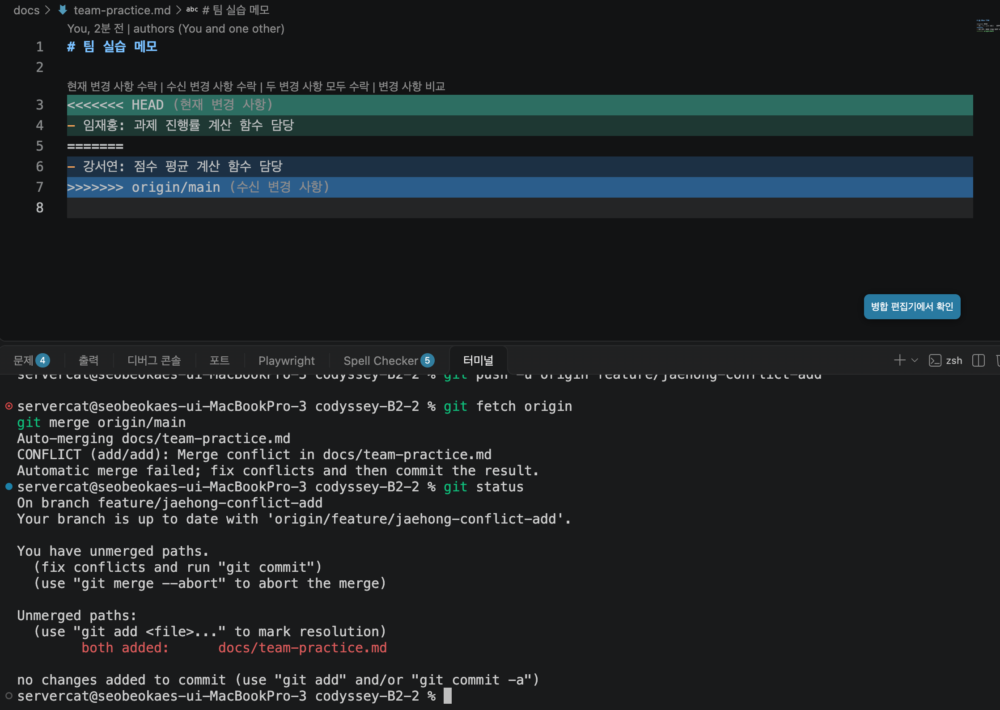

# Conflict Resolution Log

> 실제 충돌 해결 후 아래 양식을 복사해 채웁니다. (팀 최소 2회, 1회 이상 비자명 충돌)

## 📌 충돌 기록 1회차

### 참여자
- 작성자: 임재홍(`sarguments`)
- 상대: 강서연(`5312ksy-beep`)

### 상황 (대상 브랜치·파일)
- 공통 시작 커밋: `e1e8d5b`
- 브랜치: `feature/jaehong-conflict-add`(임재홍), `feature/seoyeon-conflict-add`(강서연)
- 파일: `docs/team-practice.md` — 공통 원본에 없던 파일을 양쪽 브랜치에서 같은 경로에 새로 추가

### 충돌 내용 (Conflict markers)
```text
# 팀 실습 메모

<<<<<<< HEAD
- 임재홍: 과제 진행률 계산 함수 담당
=======
- 강서연: 점수 평균 계산 함수 담당
>>>>>>> origin/main
```

### 해결 절차와 선택 이유
- 재현: 두 브랜치에서 같은 경로에 파일을 각각 추가 → 강서연 PR 선행 병합 → 임재홍 브랜치에서 `git merge origin/main`
- 실제 수행한 명령: `git fetch origin`, `git merge origin/main`, `git status`, `git add docs/team-practice.md docs/conflict-resolution.md`, `git commit`
- 선택한 전략: keep both(양쪽 유지). 서로 다른 담당 정보는 의미가 겹치지 않으므로 모두 남기고, 양쪽에 같은 제목이 중복된 부분만 하나로 합쳤다.

### 검증 결과
- 제목이 한 번만 나오고 담당자 두 줄이 모두 남았다.
- 실습 파일에 충돌 마커가 없고, Markdown 미리보기에서 정상 표시됐다.
- `git status`에서 미해결 경로가 사라진 것을 확인했다.

### 증빙 링크 (PR/커밋)
- 충돌 재현 화면: 아래 이미지, 원본 댓글 https://github.com/codyssey-b2-2-team1/codyssey-B2-2/issues/20#issuecomment-7059289155



- 강서연 PR: https://github.com/codyssey-b2-2-team1/codyssey-B2-2/pull/21
- 이슈: https://github.com/codyssey-b2-2-team1/codyssey-B2-2/issues/20

### 배운 점
- 공통 원본에 없던 파일도 양쪽에서 같은 경로로 추가하면 `add/add` 충돌이 난다. 두 사람 모두 같은 `main`에서 시작했으므로 각자 커밋만 봐서는 알 수 없고, 병합 시점에 드러난다.


<br>

## 📌 충돌 기록 2회차

### 참여자
- 작성자: 김수민(`cody2620`)
- 상대: 윤정민(`yj-min-i`)

### 상황(What happened)
- 충돌 발생 브랜치: `feature/sumin-conflict-init-export`와 `feature/jeongmin-init-export`
- 충돌 발생 파일: `src/__init__.py`

### 충돌 내용(Conflict markers)
```txt
<<<<<<< feature/sumin-conflict-init-export
from .deadlines import days_until
=======
from .study_time import format_study_time
>>>>>>> main
```


### 해결 과정(How)
- keep both : days_until과 format_study_time 두 함수 모두 필요해서 남기기로 결정했다.
- Pull Request에서 제공해주는 'Resolve conflicts' 기능으로 충돌 마커를 삭제하고 수정완료함.

### 검증 결과
- https://github.com/codyssey-b2-2-team1/codyssey-B2-2/pull/25/changes
  

### 증빙 링크 (PR/커밋)
- 해결 PR: https://github.com/codyssey-b2-2-team1/codyssey-B2-2/pull/25
- 충돌 재현 화면


- 해결 커밋: https://github.com/codyssey-b2-2-team1/codyssey-B2-2/commit/5c629b0f735f6ac11b6a3937ec133003947582bf

- 관련 이슈: https://github.com/codyssey-b2-2-team1/codyssey-B2-2/issues/32

- 상대 PR: https://github.com/codyssey-b2-2-team1/codyssey-B2-2/pull/25

### 배운 점(Learnings)
- commit/push 수행 전에 동료들과 소통하는 것이 중요하다고 느꼈다.

