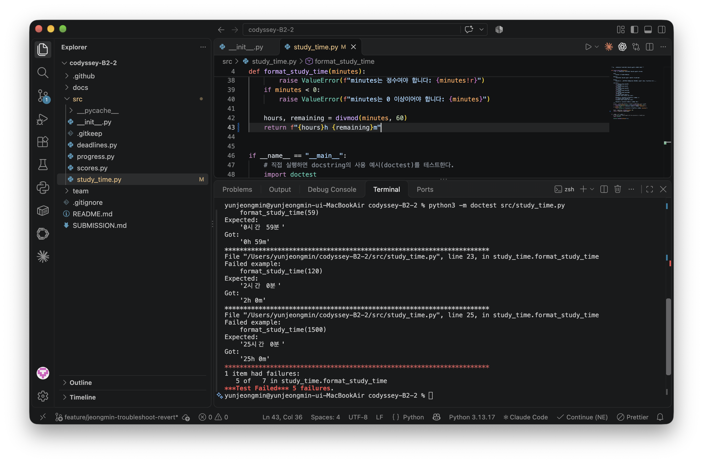
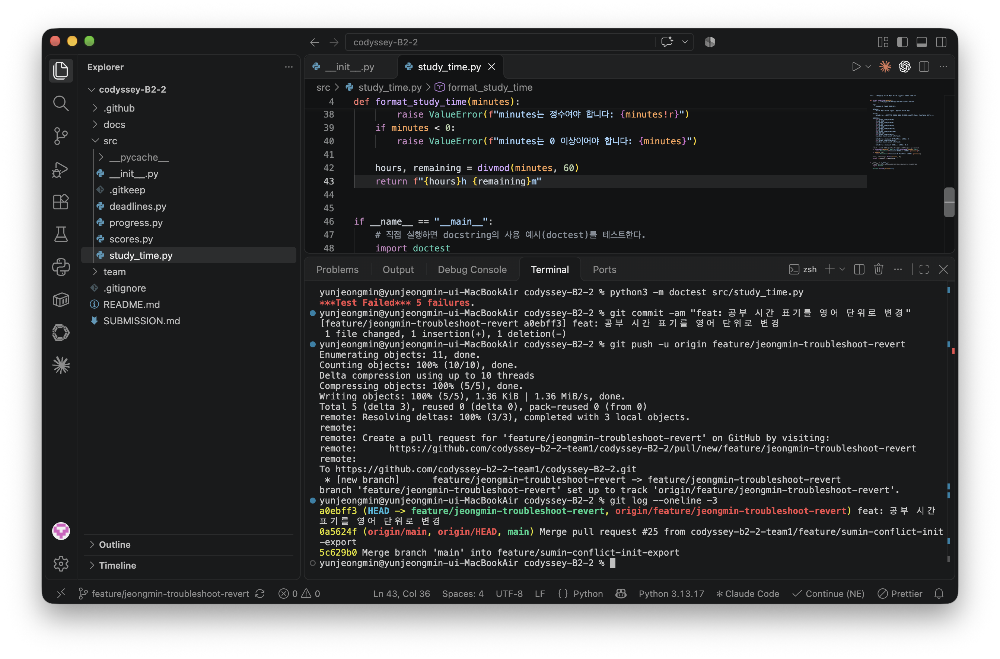
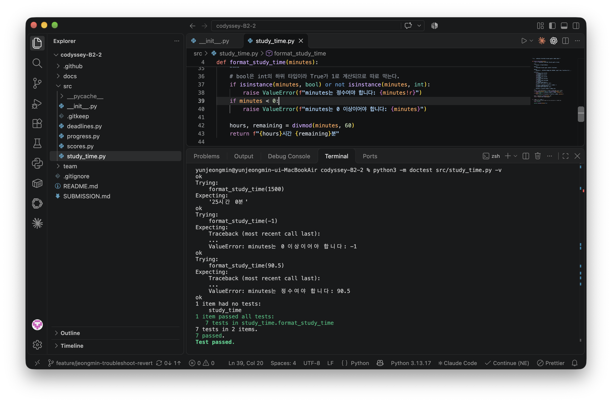
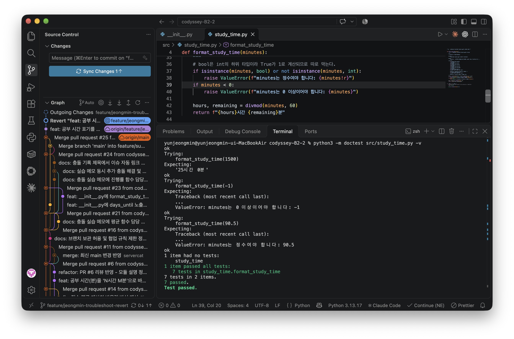

# Troubleshooting Log

> amend 기록과 같은 형식(참여자·상황·명령·결과·주의점·선택 이유·증빙)으로 reset --soft, revert, stash / stash pop 기록을 아래에 추가합니다. 맨 아래 공통 기록 양식을 복사해 사용합니다. (팀 전체 4종, 전원 최소 1개 기록 작성 참여)

## 공통 기록 양식

아래 Markdown 양식을 복사해 각자의 실습 기록을 추가합니다. 수행한 내용과 실제 결과를 채우고, 기존 팀원의 기록은 유지합니다.

````markdown
## 시나리오: <reset --soft | revert | stash / stash pop>

### 참여자·역할
- <이름>(실행), <이름>(기록)

### 상황·재현 절차
- 시작 상태와 문제가 생긴 상황:
- 실습 브랜치:
- 재현 절차:

### 수행 명령
```bash
git ...
```

### 결과
- 실행 전 상태:
- 실행 후 상태:
- 파일·커밋·브랜치에 생긴 변화:

### 주의점 (원격 히스토리·협업 영향)
-

### 이 방법을 선택한 이유
-

### 증빙 링크
- Issue:
- 실행 화면 또는 실제 명령·출력 기록:
- 관련 PR·커밋:
````


## 시나리오: git commit --amend

push 전 개인 커밋의 메시지를 amend로 수정하고, 수정 전후 기록과 파일 내용 유지 여부를 확인했습니다.

### 참여자·역할
- 강서연: 실행 및 기록

### 상황·재현 절차
- 실습 기록 초안을 커밋한 뒤, 최근 커밋의 메시지를 더 구체적으로 수정하는 상황을 실습했다.
- 개인 실습 브랜치: `feature/seoyeon-amend`
- 첫 커밋 후 push하지 않은 상태에서 수정 전 로그를 남기고 amend를 실행했다.

### 수행 명령
```bash
git add docs/troubleshooting-log.md
git commit -m "docs: 트러블슈팅 실습 기록 추가"
git log -1 --oneline
git commit --amend -m "docs: 최근 커밋 메시지 수정 실습 기록 추가"
git log -1 --oneline
```

파일 내용 유지 여부 확인:

```bash
git diff 0b400e4 999d037 -- docs/troubleshooting-log.md
```

### 결과
- 수정 전 커밋: `0b400e48531c73edd0406bddc35d3ef2008bdab5`
- 수정 전 메시지: `docs: 트러블슈팅 실습 기록 추가`
- 수정 후 커밋: `999d0372881ed6d75a3b71119dd8fcb0208bdc58`
- 수정 후 메시지: `docs: 최근 커밋 메시지 수정 실습 기록 추가`
- 커밋 번호와 메시지는 변경됐으며, 두 커밋 사이의 파일 비교 결과에는 차이가 없었다.
- 두 커밋의 트리 해시도 `06ba2e2f1d4db56abd350e593aab3df0db9c67c2`로 같아 전체 파일 스냅샷이 유지된 것을 확인했다.

실행 로그 요약:

```text
수정 전: 0b400e4 docs: 트러블슈팅 실습 기록 추가
수정 후: 999d037 docs: 최근 커밋 메시지 수정 실습 기록 추가
git diff 결과: 출력 없음 (파일 내용 동일)
```

### 주의점 (원격 히스토리·협업 영향)
- 아직 push하지 않은 개인 커밋을 대상으로 진행한다.
- amend는 최근 커밋을 새 커밋으로 대체하므로 커밋 번호가 바뀐다.
- 이미 push한 커밋을 amend하면 원격 브랜치와 기록이 달라진다. 수정한 기록으로 원격을 덮어쓰려면 강제 push가 필요할 수 있고, 기존 커밋을 기준으로 작업하던 팀원과 기록이 어긋날 수 있어 이번 실습은 push 전에 진행했다.
- 수정 전 커밋 번호와 메시지를 미리 복사하거나 캡처한다.

### 이 방법을 선택한 이유
- 파일 내용을 유지하면서 최근 커밋의 설명만 수정하기 위해 사용한다.

### 증빙 링크
- Issue: https://github.com/codyssey-b2-2-team1/codyssey-B2-2/issues/26
- 수정 전후 실행 증빙: 위 수행 명령, 실제 커밋 번호와 실행 로그 요약
- [수정 전후 터미널 실행 화면](images/amend-before-after.png)
- 관련 PR: https://github.com/codyssey-b2-2-team1/codyssey-B2-2/pull/28

수정 전 커밋은 push 전에 amend로 대체되어 GitHub 원격 기록에서는 확인할 수 없으므로, 실제 터미널 캡처를 함께 첨부한다.


## 시나리오: git revert

원격 브랜치에 이미 push된 잘못된 커밋을 `git revert`로 되돌리고, 히스토리를 지우지 않고 복구되는 것을 확인했습니다.

### 참여자·역할
- 윤정민(`yj-min-i`): 실행 및 기록

### 상황·재현 절차
- 시작 상태와 문제가 생긴 상황: `src/study_time.py`의 반환 형식을 `"N시간 M분"`에서 `"Nh Mm"`으로 잘못 바꾼 커밋을 원격 브랜치에 push했다. 그 결과 docstring 사용 예시(doctest)가 실패했다.
- 실습 브랜치: `feature/jeongmin-troubleshoot-revert`
- 재현 절차:
  1. 최신 main에서 브랜치 생성
  2. `return f"{hours}시간 {remaining}분"` → `return f"{hours}h {remaining}m"`으로 수정
  3. `python3 -m doctest src/study_time.py` 실행 → 실패 확인
  4. 커밋 후 push → 이미 원격에 공유된 상태

### 수행 명령
```bash
git commit -am "feat: 공부 시간 표기를 영어 단위로 변경"
git push -u origin feature/jeongmin-troubleshoot-revert
git log --oneline -3
git revert HEAD --no-edit
git log --oneline -3
python3 -m doctest src/study_time.py -v
git push
```

### 결과
- 실행 전 상태:
  ```text
  a0ebff3 feat: 공부 시간 표기를 영어 단위로 변경
  0a5624f Merge pull request #25 from codyssey-b2-2-team1/feature/sumin-conflict-init-export
  5c629b0 Merge branch 'main' into feature/sumin-conflict-init-export
  ```
- 실행 후 상태:
  ```text
  c6f04b4 Revert "feat: 공부 시간 표기를 영어 단위로 변경"
  a0ebff3 feat: 공부 시간 표기를 영어 단위로 변경
  0a5624f Merge pull request #25 from codyssey-b2-2-team1/feature/sumin-conflict-init-export
  ```
- 파일·커밋·브랜치에 생긴 변화: 잘못된 커밋 `a0ebff3`은 기록에 그대로 남고, 그 변경을 취소하는 새 커밋 `c6f04b4`가 추가됐다. `src/study_time.py`는 원래 코드로 돌아왔고 doctest 7개가 다시 통과했다. push는 강제 옵션 없이 일반 `git push`로 완료됐다.

### 주의점 (원격 히스토리·협업 영향)
- 이미 push한 커밋을 `reset`으로 지우면 원격과 히스토리가 달라져 강제 push가 필요하고, 그 커밋을 받은 팀원의 기록과 어긋난다.
- `revert`는 새 커밋을 추가할 뿐이라 일반 push로 끝나고, 다른 팀원 작업에 영향을 주지 않는다.
- 되돌린 뒤 바로 다른 브랜치(main)를 pull하면 맨 위가 병합 커밋이 되므로, revert는 pull 전에 실행했다. 병합 커밋을 되돌려야 할 때는 `git revert -m 1 <병합 커밋>`처럼 기준 부모를 지정해야 한다.

### 이 방법을 선택한 이유
- 잘못된 커밋이 이미 원격에 공유된 상태라, 히스토리를 지우는 `reset` 대신 기록을 보존하는 `revert`를 선택했다. 무엇을 왜 되돌렸는지가 커밋으로 남아 추적도 쉽다.

### 증빙 링크
- Issue: https://github.com/codyssey-b2-2-team1/codyssey-B2-2/issues/29
- 잘못된 커밋: https://github.com/codyssey-b2-2-team1/codyssey-B2-2/commit/a0ebff32eb124209be56a8f04d0142bdc7537759
- revert 커밋: https://github.com/codyssey-b2-2-team1/codyssey-B2-2/commit/c6f04b4eadfdbf42982bda1cb60b85a15a39da0f
- 실행 화면:






