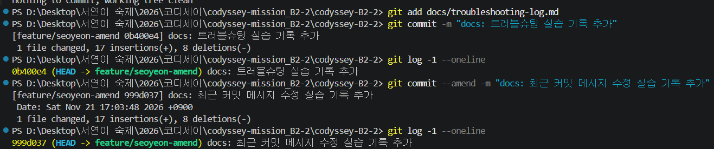
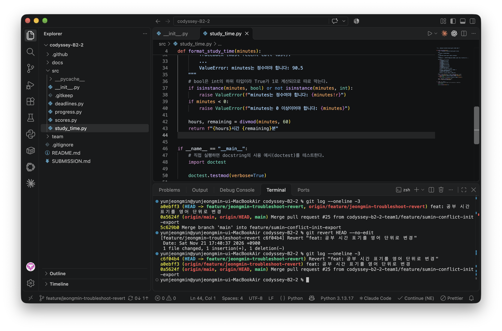

# Troubleshooting Log

> amend 기록과 같은 형식(참여자·상황·명령·결과·주의점·선택 이유·증빙)으로 reset --soft, revert, stash / stash pop 기록을 아래에 추가합니다. 맨 아래 공통 기록 양식을 복사해 사용합니다. (팀 전체 4종, 전원 최소 1개 기록 작성 참여)

## 공통 기록 양식

아래 Markdown 양식을 복사해 각자의 실습 기록을 추가합니다. 수행한 내용과 실제 결과를 채우고, 기존 팀원의 기록은 유지합니다.

````markdown
## 시나리오: <reset --soft | revert | stash / stash pop>

### 참여자·역할
- <이름>(실행), <이름>(기록)

### 상황·재현 절차
- 시작 상태와 문제가 생긴 상황:
- 실습 브랜치:
- 재현 절차:

### 수행 명령
```bash
git ...
```

### 결과
- 실행 전 상태:
- 실행 후 상태:
- 파일·커밋·브랜치에 생긴 변화:

### 주의점 (원격 히스토리·협업 영향)
-

### 이 방법을 선택한 이유
-

### 증빙 링크
- Issue:
- 실행 화면 또는 실제 명령·출력 기록:
- 관련 PR·커밋:
````


## 📌시나리오: git commit --amend

push 전 개인 커밋의 메시지를 amend로 수정하고, 수정 전후 기록과 파일 내용 유지 여부를 확인했습니다.

### 참여자·역할
- 강서연: 실행 및 기록

### 상황·재현 절차
- 실습 기록 초안을 커밋한 뒤, 최근 커밋의 메시지를 더 구체적으로 수정하는 상황을 실습했다.
- 개인 실습 브랜치: `feature/seoyeon-amend`
- 첫 커밋 후 push하지 않은 상태에서 수정 전 로그를 남기고 amend를 실행했다.

### 수행 명령
```bash
git add docs/troubleshooting-log.md
git commit -m "docs: 트러블슈팅 실습 기록 추가"
git log -1 --oneline
git commit --amend -m "docs: 최근 커밋 메시지 수정 실습 기록 추가"
git log -1 --oneline
```

파일 내용 유지 여부 확인:

```bash
git diff 0b400e4 999d037 -- docs/troubleshooting-log.md
```

### 결과
- 수정 전 커밋: `0b400e48531c73edd0406bddc35d3ef2008bdab5`
- 수정 전 메시지: `docs: 트러블슈팅 실습 기록 추가`
- 수정 후 커밋: `999d0372881ed6d75a3b71119dd8fcb0208bdc58`
- 수정 후 메시지: `docs: 최근 커밋 메시지 수정 실습 기록 추가`
- 커밋 번호와 메시지는 변경됐으며, 두 커밋 사이의 파일 비교 결과에는 차이가 없었다.
- 두 커밋의 트리 해시도 `06ba2e2f1d4db56abd350e593aab3df0db9c67c2`로 같아 전체 파일 스냅샷이 유지된 것을 확인했다.

실행 로그 요약:

```text
수정 전: 0b400e4 docs: 트러블슈팅 실습 기록 추가
수정 후: 999d037 docs: 최근 커밋 메시지 수정 실습 기록 추가
git diff 결과: 출력 없음 (파일 내용 동일)
```

### 주의점 (원격 히스토리·협업 영향)
- 아직 push하지 않은 개인 커밋을 대상으로 진행한다.
- amend는 최근 커밋을 새 커밋으로 대체하므로 커밋 번호가 바뀐다.
- 이미 push한 커밋을 amend하면 원격 브랜치와 기록이 달라진다. 수정한 기록으로 원격을 덮어쓰려면 강제 push가 필요할 수 있고, 기존 커밋을 기준으로 작업하던 팀원과 기록이 어긋날 수 있어 이번 실습은 push 전에 진행했다.
- 수정 전 커밋 번호와 메시지를 미리 복사하거나 캡처한다.

### 이 방법을 선택한 이유
- 파일 내용을 유지하면서 최근 커밋의 설명만 수정하기 위해 사용한다.

### 증빙 링크
- Issue: https://github.com/codyssey-b2-2-team1/codyssey-B2-2/issues/26
- 수정 전후 실행 증빙: 위 수행 명령, 실제 커밋 번호와 실행 로그 요약
- [수정 전후 터미널 실행 화면](images/amend-before-after.png)
- 관련 PR: https://github.com/codyssey-b2-2-team1/codyssey-B2-2/pull/28

수정 전 커밋은 push 전에 amend로 대체되어 GitHub 원격 기록에서는 확인할 수 없으므로, 실제 터미널 캡처를 함께 첨부한다.




## 📌시나리오: git reset --soft HEAD~1

push 전 개인 커밋을 `reset --soft HEAD~1`로 취소하고, 변경 내용은 스테이징 상태로 남긴 채 커밋 메시지를 바꿔 다시 커밋했습니다.

### 참여자·역할
- 김수민(`cody2620`): 실행 및 기록

### 상황·재현 절차
- 시작 상태와 실습 목적: src/deadlines.py의 _parse_date에서 try/except를 주석 처리한 변경을 reset --soft HEAD~1 실습이라는 메시지로 커밋한 뒤, git reset --soft HEAD~1로 마지막 커밋만 취소하고 변경 내용이 스테이징 상태로 남는지 확인하는 실습이다.
- 실습 브랜치: `feature/sumin-trouble-reset` (`main`의 `b4b875f`에서 분기)
- 재현 절차:
  1. `src/deadlines.py`를 수정하고 `reset --soft HEAD~1 실습` 메시지로 커밋한다. (`51a1a57`)
  2. `git reset --soft HEAD~1`로 커밋만 취소한다.
  3. `git status`로 변경이 스테이징된 상태로 남아 있는지 확인한다.
  4. 같은 변경을 `docs: git --reset soft HEAD~1 실습` 메시지로 다시 커밋한다. (`b0eb471`)

### 수행 명령
```bash
git commit -am "reset --soft HEAD~1 실습"
git log -1 --oneline
git reset --soft HEAD~1
git status --short
git commit -m "docs: git --reset soft HEAD~1 실습"
git log -1 --oneline
git reflog -5
```

### 결과
- 실행 전 상태: `HEAD`는 `51a1a57 reset --soft HEAD~1 실습`, 부모는 `b4b875f`.
- 실행 후 상태: `HEAD`가 `b4b875f`로 이동했고, `51a1a57`의 변경(`src/deadlines.py`, 6줄 추가·4줄 삭제)은 스테이징 영역(`M  src/deadlines.py`)에 그대로 남았다.
- 파일·커밋·브랜치에 생긴 변화:
  - 재커밋 후 새 커밋 `b0eb471 docs: git --reset soft HEAD~1 실습`이 만들어졌다.
  - `git diff --stat 51a1a57 b0eb471`은 출력이 없어 두 커밋의 파일 내용이 같고, 커밋 번호와 메시지만 달라졌다.
  - 브랜치는 그대로이며 `51a1a57`은 브랜치에서 빠져 reflog에만 남는다.

실제 `git reflog` 기록:

```text
b0eb471 HEAD@{2}: commit: docs: git --reset soft HEAD~1 실습
b4b875f HEAD@{3}: reset: moving to HEAD~1
51a1a57 HEAD@{4}: commit: reset --soft HEAD~1 실습
```


### 주의점 (원격 히스토리·협업 영향)
- push하지 않은 개인 브랜치의 커밋만 대상으로 했다. 원격에는 재커밋한 `b0eb471`만 올라가 있고 `51a1a57`은 올라간 적이 없다.
- 이미 push한 커밋에 `reset`을 쓰면 로컬과 원격 이력이 갈라져 강제 push가 필요하고, 그 커밋을 기준으로 작업하던 팀원과 이력이 어긋난다. 공유 브랜치에서는 쓰지 않고 `revert`를 사용한다.
- `--soft`는 파일과 스테이징을 건드리지 않지만, `--hard`는 작업 내용을 지운다. 옵션을 확인하고 실행한다.
- 취소한 커밋 번호는 `git reflog`로 찾을 수 있으니 실행 전 번호를 기록해 둔다.

### 이 방법을 선택한 이유
- 변경 내용은 그대로 두고 최근 커밋만 취소해 메시지와 커밋 단위를 다시 정리하기 위해 사용한다.
- `--mixed`는 스테이징까지 풀고 `--hard`는 변경을 삭제하므로, 같은 내용을 바로 재커밋하는 이번 상황에는 `--soft`가 맞다.
- 메시지만 바꾸는 경우라면 `amend`로 충분하지만, 이번에는 커밋 취소 후 스테이징 상태 확인까지 실습하는 것이 목적이었다.

### 증빙 링크
- Issue: https://github.com/codyssey-b2-2-team1/codyssey-B2-2/issues/33
- 실행 화면 또는 실제 명령·출력 기록: 위 수행 명령과 `git reflog` 기록
- 관련 PR·커밋: 재커밋 `b0eb471`, 취소한 커밋 `51a1a57`


## 📌시나리오: git revert

원격 브랜치에 이미 push된 잘못된 커밋을 `git revert`로 되돌리고, 히스토리를 지우지 않고 복구되는 것을 확인했습니다.

### 참여자·역할
- 윤정민(`yj-min-i`): 실행 및 기록

### 상황·재현 절차
- 시작 상태와 문제가 생긴 상황: `src/study_time.py`의 반환 형식을 `"N시간 M분"`에서 `"Nh Mm"`으로 잘못 바꾼 커밋을 원격 브랜치에 push했다. 그 결과 docstring 사용 예시(doctest)가 실패했다.
- 실습 브랜치: `feature/jeongmin-troubleshoot-revert`
- 재현 절차:
  1. 최신 main에서 브랜치 생성
  2. `return f"{hours}시간 {remaining}분"` → `return f"{hours}h {remaining}m"`으로 수정
  3. `python3 -m doctest src/study_time.py` 실행 → 실패 확인
  4. 커밋 후 push → 이미 원격에 공유된 상태

### 수행 명령
```bash
git commit -am "feat: 공부 시간 표기를 영어 단위로 변경"
git push -u origin feature/jeongmin-troubleshoot-revert
git log --oneline -3
git revert HEAD --no-edit
git log --oneline -3
python3 -m doctest src/study_time.py -v
git push
```

### 결과
- 실행 전 상태:
  ```text
  a0ebff3 feat: 공부 시간 표기를 영어 단위로 변경
  0a5624f Merge pull request #25 from codyssey-b2-2-team1/feature/sumin-conflict-init-export
  5c629b0 Merge branch 'main' into feature/sumin-conflict-init-export
  ```
- 실행 후 상태:
  ```text
  c6f04b4 Revert "feat: 공부 시간 표기를 영어 단위로 변경"
  a0ebff3 feat: 공부 시간 표기를 영어 단위로 변경
  0a5624f Merge pull request #25 from codyssey-b2-2-team1/feature/sumin-conflict-init-export
  ```
- 파일·커밋·브랜치에 생긴 변화: 잘못된 커밋 `a0ebff3`은 기록에 그대로 남고, 그 변경을 취소하는 새 커밋 `c6f04b4`가 추가됐다. `src/study_time.py`는 원래 코드로 돌아왔고 doctest 7개가 다시 통과했다. push는 강제 옵션 없이 일반 `git push`로 완료됐다.

### 주의점 (원격 히스토리·협업 영향)
- 이미 push한 커밋을 `reset`으로 지우면 원격과 히스토리가 달라져 강제 push가 필요하고, 그 커밋을 받은 팀원의 기록과 어긋난다.
- `revert`는 새 커밋을 추가할 뿐이라 일반 push로 끝나고 기존 이력은 보존된다. 다만 되돌린 코드에 다른 작업이 의존하고 있을 수 있으므로, revert 후 영향을 받는 코드가 없는지 확인해야 한다.
- 이번 실습에서는 잘못된 커밋이 맨 위(HEAD)에 있어 `git revert HEAD`를 썼지만, pull이나 다른 커밋으로 HEAD가 바뀔 수 있으므로 `git log --oneline`으로 대상을 확인한 뒤 `git revert <대상 커밋 번호>`(예: `git revert a0ebff3`)처럼 되돌릴 커밋을 명확히 지정하는 것이 안전하다. 병합 커밋을 되돌려야 할 때는 `git revert -m 1 <병합 커밋>`처럼 기준 부모를 지정해야 한다.

### 이 방법을 선택한 이유
- 잘못된 커밋이 이미 원격에 공유된 상태라, 히스토리를 지우는 `reset` 대신 기록을 보존하는 `revert`를 선택했다. 무엇을 왜 되돌렸는지가 커밋으로 남아 추적도 쉽다.

### 증빙 링크
- Issue: https://github.com/codyssey-b2-2-team1/codyssey-B2-2/issues/29
- 잘못된 커밋: https://github.com/codyssey-b2-2-team1/codyssey-B2-2/commit/a0ebff32eb124209be56a8f04d0142bdc7537759
- revert 커밋: https://github.com/codyssey-b2-2-team1/codyssey-B2-2/commit/c6f04b4eadfdbf42982bda1cb60b85a15a39da0f
- 실행 화면:





## 📌시나리오: git stash / git stash pop

추적 파일 수정과 추적하지 않는 새 파일을 보관·복원하고, 같은 줄을 양쪽에서 다르게 수정해 복원 충돌을 재현한 뒤 해결·정리까지 확인했습니다.

### 참여자·역할
- 임재홍(`sarguments`): 실행 및 기록

### 상황·재현 절차
- 시작 상태와 문제가 생긴 상황: `docs/team-practice.md`에 두 사람 담당 줄이 들어 있는 상태에서, 작업 중 다른 브랜치로 옮겨야 하는 상황을 가정했다.
- 실습 브랜치: `feature/jaehong-stash-log`에서 만든 임시 브랜치 `stash-test`
- 재현 절차:
  1. 추적 파일을 수정하고 새 파일 `stash-test2.tmp`를 만든다.
  2. `git stash -u`로 함께 보관하고 `git status --short`가 비는지 본다.
  3. `git stash pop`으로 복원한다.
  4. 같은 줄을 스태시와 작업 트리에서 서로 다르게 바꿔 `git stash pop` 충돌을 만든다.
  5. 마커를 지우고 `git add`·`git stash drop`으로 마무리한다.

### 수행 명령
```bash
git switch -c stash-test

# 1) 새 파일 포함 여부
echo 'scratch2' > stash-test2.tmp
printf '\n-u 확인\n' >> docs/team-practice.md
git stash -u
git status --short
git stash pop

# 2) 복원 충돌 재현
sed -i '' 's/^- 강서연: 점수 평균 계산 함수 담당$/- 강서연: 점수 평균·중앙값 계산 함수 담당/' docs/team-practice.md
git stash
sed -i '' 's/^- 강서연: 점수 평균 계산 함수 담당$/- 강서연: 점수 평균 전용 함수 담당/' docs/team-practice.md
git commit -am "test: stash 복원 충돌 재현"
git stash pop

# 3) 충돌 해결과 마무리
git add docs/team-practice.md
git stash drop
```

### 결과
- 실행 전 상태: `M docs/team-practice.md`, `?? stash-test.tmp`, `?? stash-test2.tmp`
- `-u` 없이 보관하면 추적하지 않는 새 파일은 보관되지 않아 워킹트리에 남는다.
- `git stash -u` 직후 `git status --short`는 비었고, `git stash pop` 후 추적 파일 수정과 새 파일 `stash-test2.tmp`가 함께 돌아왔다.
- 복원 충돌 시 실제 마커:

```text
<<<<<<< Updated upstream
- 강서연: 점수 평균 전용 함수 담당
=======
- 강서연: 점수 평균·중앙값 계산 함수 담당
>>>>>>> Stashed changes
- 임재홍: 과제 진행률 계산 함수 담당
```

- 함께 출력된 메시지: `CONFLICT (content): Merge conflict in docs/team-practice.md`, `The stash entry is kept in case you need it again.`
- 실행 후 상태: 마커 세 줄을 지우고 그 줄을 `- 강서연: 점수 평균·중앙값 계산 전용 함수 담당`으로 합쳤다. `git add docs/team-practice.md` 뒤 `git stash drop`을 실행해 `Dropped refs/stash@{0} (d0cdf2af…)`를 확인했고, 이후 `git status --short`는 `M  docs/team-practice.md`, `git stash list`는 비어 있었다.
- 파일·커밋·브랜치에 생긴 변화: 실습 브랜치 `stash-test`는 push하지 않았고 실습 후 삭제했다. 공유 브랜치 이력은 바뀌지 않았다.

### 주의점 (원격 히스토리·협업 영향)
- 충돌한 `pop`은 stash를 지우지 않는다. 마커를 제거하고 `git add`로 해결한 뒤 `git stash drop`으로 그 항목만 지운다. `git stash clear`는 다른 작업의 stash까지 모두 지우므로 쓰지 않는다.
- `git stash list`로 남은 항목을 먼저 확인하고, 지울 때는 대상 하나를 지정한다.
- `-u` 없이 보관하면 새 파일이 워킹트리에 남아 브랜치를 바꿔도 따라간다. 새 파일까지 정리하려면 `-u`를 쓴다.
- 실습은 push하지 않은 임시 브랜치에서만 한다.

### 이 방법을 선택한 이유
- 작업 중 긴급히 브랜치를 옮겨야 할 때 커밋을 만들지 않고 변경을 보존할 수 있다.
- `reset --soft`는 이력 재작성, `revert`는 취소 커밋 생성이라 미커밋 변경 보관 목적에는 stash가 맞다.

### 증빙 링크
- Issue: https://github.com/codyssey-b2-2-team1/codyssey-B2-2/issues/27
- 실행 명령과 출력: 위 수행 명령·결과
- 관련 PR·커밋: https://github.com/codyssey-b2-2-team1/codyssey-B2-2/pull/31
